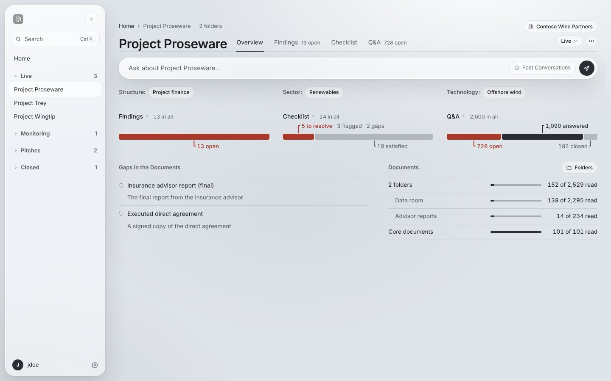
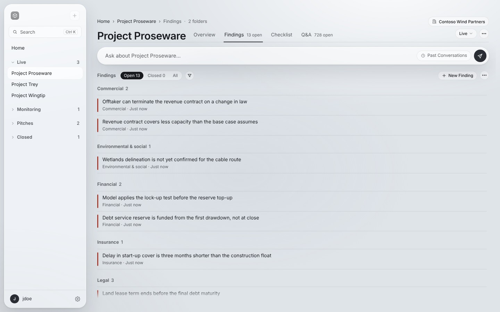
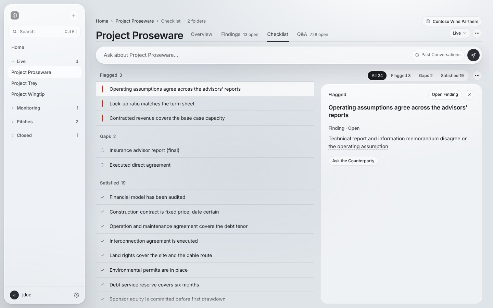
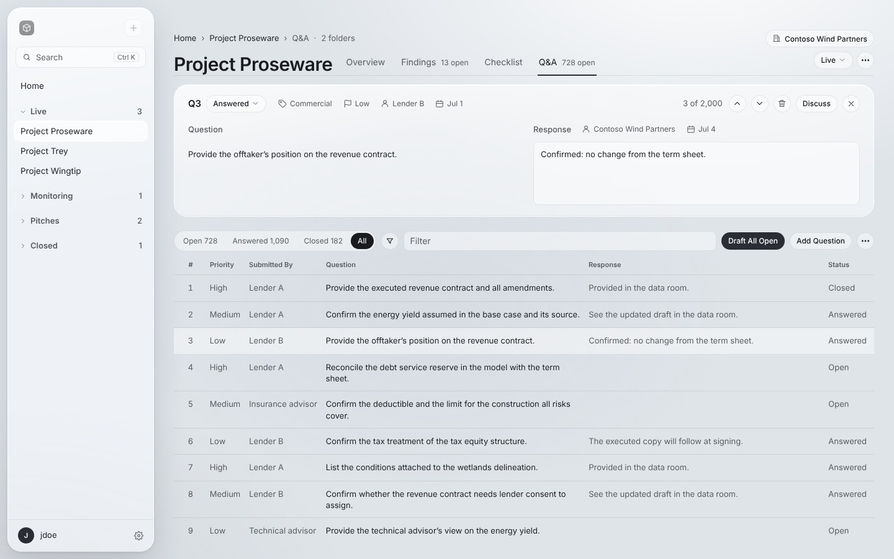
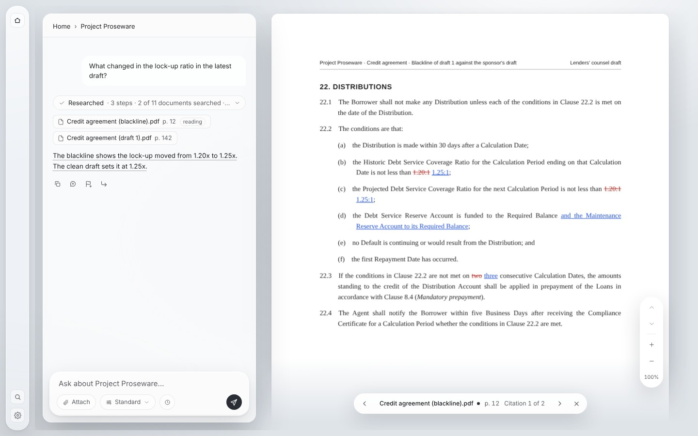
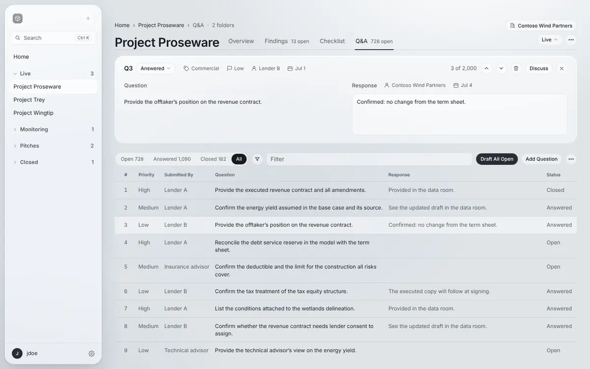

<h1 align="center">Punchlist</h1>

<b>A Windows desktop prototype for project finance due diligence.</b> 
Punchlist checks deal documents against a master checklist and cites the pages that support its findings.

  <a href="#what-it-does">What it does</a> ·
  <a href="#how-it-works">How it works</a> ·
  <a href="#try-the-browser-demo">Try the demo</a> ·
  <a href="#install">Install</a> ·
  <a href="#get-started">Get started</a> ·
  <a href="#for-developers">For developers</a>

  

## What it does

Add a deal and link its data room folders. Punchlist indexes the supported documents it can read and checks the deal
against the master checklist. Findings and answers can cite the supporting documents and pages. Checklist gaps show
where evidence is missing.

### Overview

See where the deal stands on one page: open findings, checklist items still to resolve, open and answered questions, documents still missing, and how much of the data room has been read.

### Findings

Findings state the problem, include citations when available, and are grouped by workstream. When a new document or
a counterparty response bears on an open finding, the finding is marked **May be out of date**. Export findings to Excel.

  

### Checklist

The master checklist supplies a general list and lists by structure, sector, and technology. To manage those lists,
choose **Open** in the **Checklist** row in **Settings**. The app calls this dialog **Firm’s Checklist**.

Deal checklist results include:

- **Satisfied**, with a document citation when available
- **Flagged**, with the finding it raised
- **Gap**, with what is missing

When new documents arrive, choose **Check Again** from the **⋯** menu at the top of the deal's page.

  

### Q&amp;A

The Q&amp;A log holds the deal team's questions to the counterparty and the responses to them. Punchlist handles logs
with 2,000 questions or more. Import and export the log spreadsheet and see which responses changed since the last
round. Punchlist can draft a response using documents or earlier responses. The team decides whether to use it.

  

### Ask and read the source

Ask in plain English about one deal or across all of them. Punchlist searches the data room and reads the most
relevant documents. When an answer includes a citation, click it to open the page or spreadsheet cell beside the
conversation.

  

### Dark mode

Punchlist has a native dark mode. By default it matches the Windows light or dark setting. To choose one yourself, click your name at the bottom of the sidebar (beside the gear icon) to open **Settings**, then click **Light** or **Dark** next to **Appearance**. To go back to the default, click **Match Windows**.

  

### Also included

- **Deal memo.** From the **⋯** menu at the top of the deal's page, choose **Deal Memo…** to create a Word or PDF
  memo of the findings, checklist, and Q&amp;A. The memo reports facts and makes no recommendation.
- **Search.** Press Ctrl K to search deals, findings, checklist items, questions, and documents.
- **Drafts.** Earlier drafts of an agreement stay listed under the latest one, and you can compare any two. Tracked changes are read directly from the Word file.
- **Restore.** Bring back deleted findings and questions, and see who deleted them and when.

## How it works

- **Shared across the team.** Deals, findings, and the Q&amp;A are stored in the Punchlist folder. OneDrive provides
  automatic folder discovery and sync. You can also select a folder manually. If two people change the same item
  at once, Punchlist keeps both versions until someone picks one.
- **The data room stays where it is.** Punchlist reads documents in linked folders in place and builds a search index
  on each PC. Files you attach directly may be copied into the shared Punchlist folder.
- **Connects to a model provider.** Punchlist supports Anthropic, OpenAI-compatible services, Cohere North, Azure
  OpenAI, Amazon Bedrock, Google Vertex AI, and custom model gateways.
- **People decide.** Checks update checklist results and can raise or flag findings. People decide when to close
  findings or questions and whether to use draft responses.

## Try the browser demo

With Node.js 22, run `npm ci` and `npm run dev`, then open the local URL printed in the terminal.
The demo uses mock services and runs without OneDrive or an AI account.

## Install

Follow these steps to build and install the Windows app.

Set the organization name (`firm.name`) and model provider in `src/control.ts`. For OneDrive setup, you can also
set a Punchlist folder link.
The Windows installer applies those settings to each PC. Personal options such as **Appearance** are in
**Settings** inside the app.

To change a control file setting, edit `src/control.ts` and build a new installer. A PC keeps the settings it was
installed with until it gets the new build. In-place updates are still to be decided (#84).

1. Create and share the Punchlist folder, as described in [Create and share the Punchlist folder](#create-and-share-the-punchlist-folder).
2. Fill in the control file (`src/control.ts`) with the organization name, model provider, and models. If using
   a OneDrive share link, set `desktop.teamFolderLink`.
3. Build the installer on a Windows PC.
4. Install Punchlist on each PC. The installer is unsigned, so the first time it runs, Windows shows **Windows protected your PC**. Click **More info**, then click **Run anyway**.
5. Open Punchlist on your PC, sign in, and [connect the Punchlist folder](#set-up-punchlist-on-your-pc).

For details, including what each AI service needs, how to build the installer, and the checks to run after the first install, see [Windows setup requirements](docs/requirements.md).

### Create and share the Punchlist folder

Each PC on the team needs read and write access to the same Punchlist folder. For OneDrive setup, follow these
steps. For a folder outside OneDrive, give each PC access to the folder and use the manual setup below.

1. Sign in to OneDrive on the web with the account you’ll use for Punchlist, then create a folder named `Punchlist`. To use a different name, enter it as `desktop.sharedFolder` in the control file. Every PC on the team then uses that name.
2. Share the folder with everyone on the team. Select the folder, click **Share**, enter each person's name or email address, set the permission to **Can edit**, then click **Share**. Punchlist needs edit permission to save to the folder, and OneDrive needs it to add the folder to each person's OneDrive. When someone joins the team later, share the folder with them the same way.
3. Copy the folder's link. Select the folder, click **Share**, then click **Copy link**. If OneDrive lets you choose who the link works for, choose the option for people who already have access, so that only the people you shared the folder with in step 2 can open it. Paste the link into the control file as `desktop.teamFolderLink`.

Punchlist can open the configured link for team members during setup. See Microsoft's guides for
[sharing folders](https://support.microsoft.com/en-us/office/share-files-and-folders-in-microsoft-onedrive-9fcc2f7d-de0c-4cec-93b0-a82024800c07)
and [adding shared folders to OneDrive](https://support.microsoft.com/en-US/onedrive/add-shortcuts-to-shared-folders-in-onedrive).

## Get started

### Set up Punchlist on your PC

Install Punchlist and get edit access to the team's Punchlist folder before you start. For OneDrive setup, sign in
to the OneDrive app with an account that can access the shared folder.

Follow these steps once on each PC:

1. **Sign in.** Open Punchlist. If it prompts you to sign in to the configured model service, choose an option shown.
   - If **Single Sign-On** is available, choose it and sign in.
   - To use an API key, click **Sign In with an API Key** if needed, paste the key for the configured provider, then click **Sign In**.
2. **Connect the Punchlist folder.** If your folder is outside OneDrive, click **Choose Folder…** or
   **Choose Another…**, select the folder, then click **Use It Anyway**. Skip steps 3 and 4. For OneDrive, click
   **Open the Team Folder** when available. Otherwise, use the link from your OneDrive invitation. If prompted,
   sign in to an account with access.
3. **Add the folder to your OneDrive.** In OneDrive in the browser, find the Punchlist folder. If you don't see it, select **Shared** in the left pane. Select the circle next to the folder, then click **Add shortcut to My files** in the menu at the top. You can also right-click the folder and choose **Add shortcut to My files**. This adds the shared folder to your own OneDrive, so the OneDrive app copies it to your PC. You can then close the browser.
4. **Wait for the folder to sync.** Return to Punchlist and leave it open while OneDrive syncs. The first sync can
   take a few minutes. Punchlist connects automatically if it finds one folder that already contains Punchlist
   records. For an empty folder, confirm the suggested path with **Use This Folder**. If the suggestion is
   missing or points elsewhere, choose the folder manually and then confirm it.

Punchlist remembers the connected folder for next time.

On Windows, the app still checks whether OneDrive is running. With OneDrive closed, a reachable NAS folder can
show as out of sync and shared checks can pause on that PC. Full NAS and SMB support is tracked in #111.

#### If setup doesn't finish

- If Punchlist lists more than one folder, select the Punchlist folder synced by the OneDrive account you used in step 2, then click **Use This Folder**. If you aren't sure which one to choose, ask the person who set up Punchlist.
- If **Add shortcut to My files** isn't there, ask the person who set up Punchlist to give you **Can edit** permission.
- If Punchlist hasn't connected after 10 minutes, make sure the OneDrive app is signed in with an account that has access to the Punchlist folder and that the Punchlist folder appears inside your OneDrive folder in File Explorer. Then close Punchlist and open it again.
- If the shortcut in **My files** opens a web page instead of a folder, Punchlist can't use it yet. Microsoft lists this as a known issue in [Sync shared folders](https://support.microsoft.com/en-us/office/sync-shared-folders-dfd39a8a-80d6-44e0-b8f2-d0e4a83eb90c) and says the shortcut turns back into a folder once the issue is resolved. Until then, ask the person who set up Punchlist for help.

To change the folder later, click your name at the bottom of the sidebar (beside the gear icon) to open **Settings**, then click **Change…** next to **Punchlist Folder**.

### Work on a deal

1. **Add a deal.** Click **+** above the deal list, then click **New Deal**. (Before you have any deals, the home screen also shows a **New Deal** or **Add Deal** button.) Enter the deal's name and counterparty, and choose its structure, sector, and technology. To add the data room folders, click **Choose Folders…** or **Paste a Path**. Then click **Create and Start Indexing**.
2. **Wait for indexing to finish.** The Overview shows each folder's progress. When indexing finishes, Punchlist runs its first check and fills in the findings and the checklist.
3. **Work through the deal.** Review the findings, close the checklist's gaps, and import the Q&amp;A log. To ask about the deal, type in the box near the top of the deal's page. To ask across all deals, use the box on the home screen.
4. **Bring in the team.** Ask each team member to click **+** above the deal list, then click **Add** next to the deal.

## For developers

- [Development](docs/development.md): building, running, and testing
- [Architecture](docs/architecture.md): how the app is put together
- [Decisions](docs/decisions.md): the decisions behind it
- [Design](docs/design.md): how it looks
- The repository's **Issues** tab tracks bugs and planned work.

## License

Punchlist's original code and documentation are available under the [MIT License](LICENSE). Third-party materials
retain their own license terms.
